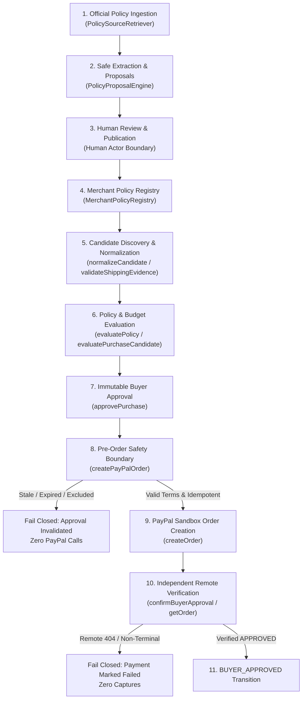

# PLINTHLY — PHASE 13D: End-to-End Evidence Enforcement and Purchase Safety Report

## 1. Executive Summary & Objectives

Phase 13D executed a complete security and reliability hardening audit across the runtime procurement pipeline of Plinthly: from retailer policy ingestion and proposal review, through candidate normalization and policy evaluation, buyer approval, pre-order boundary re-validation, PayPal order creation, and remote verification.

Key outcomes achieved:
- **Zero Real Capital Outflow:** Zero live PayPal orders created, zero capture calls executed.
- **Protected Purchase Invariants Maintained:** Read-only verification confirmed both baseline records (`pur_1792633876502_s7jvwi22` and `pur_1792654701712_f2iks5to`) remain in `BUYER_APPROVED` status with 0 captures and intact audit trails.
- **Gate 1 Cryptographic Seal Verified:** Exactly matches SHA-256 `F0449D223CBB5A7150A7538712DAF6D9C8FDA845E684781F959629144BEA5451`.
- **Test Suite Expansion:** 14 new comprehensive end-to-end integration and adversarial regression tests added (`tests/workflow/phase13d-e2e-enforcement.test.ts`), bringing total passing tests to 880 across 56 test files with 0 failures, 0 TypeScript errors, and 0 ESLint warnings.

---

## 2. Baseline Invariant Verifications

### 2.1 Gate 1 Cryptographic Hash Verification
```powershell
Get-FileHash -Algorithm SHA256 C:\paypal-gate1\gate1.mjs
# Output:
# Algorithm: SHA256
# Hash:      F0449D223CBB5A7150A7538712DAF6D9C8FDA845E684781F959629144BEA5451
# Path:      C:\paypal-gate1\gate1.mjs
```
The file contents are authentic, unmodified, and strictly locked.

### 2.2 Protected Purchase Records Inspection
Direct PostgreSQL query via `scratch/check-purchases.js` confirmed:
1. `pur_1792633876502_s7jvwi22`:
   - Status: `BUYER_APPROVED`
   - Version: `6`
   - Selected Candidate: `5e6f1929-6d17-4f00-811c-233074d2366d`
   - Active Approval: `appr_1792639866777_t41vqfaf` (invalidatedAt: null)
   - Payment Attempt: `pay_att_1792642078698_cio3e660` (paypalOrderId: `2JW38959VY1221001`, verifiedStatus: `APPROVED`)
   - Captures: 0
2. `pur_1792654701712_f2iks5to`:
   - Status: `BUYER_APPROVED`
   - Version: `5`
   - Selected Candidate: `60a76ce6-9147-4ff2-a9b1-a56f8d34e0df`
   - Active Approval: `appr_1792654761253_t0ul1938` (invalidatedAt: null)
   - Payment Attempt: `pay_att_1792654816903_rdndyocu` (paypalOrderId: `6TN25543HL618580V`, verifiedStatus: `APPROVED`)
   - Captures: 0

---

## 3. Real Execution Call Chain Trace

The complete runtime path traces across the following modules:



1. **Official Policy Ingestion:** [`PolicySourceRetriever.retrieveSource`](file:///c:/Users/Tushar%20Kumar/Desktop/Plinthly/lib/discovery/policy-ingestion/source-retriever.ts) retrieves retailer terms over HTTPS from allowlisted domains with size and timeout guards.
2. **Policy Extraction & Proposal Creation:** [`PolicyProposalEngine.proposePolicyChange`](file:///c:/Users/Tushar%20Kumar/Desktop/Plinthly/lib/discovery/policy-ingestion/proposal-engine.ts) compares extracted terms against the active registry version. If material changes or ambiguities exist, a proposed policy document is drafted.
3. **Human Review & Publication:** [`PolicyProposalEngine.approveProposal`](file:///c:/Users/Tushar%20Kumar/Desktop/Plinthly/lib/discovery/policy-ingestion/proposal-engine.ts) enforces that only human actors (`actor.kind === 'user'`) can approve or reject proposals, and rejects proposals with version conflicts.
4. **Policy Registry Lookup:** [`MerchantPolicyRegistry.getPoliciesForMerchant`](file:///c:/Users/Tushar%20Kumar/Desktop/Plinthly/lib/discovery/merchant-policy-registry.ts) returns active policies and checks active document fingerprints.
5. **Candidate Normalization & Shipping Validation:** Discovered candidates are normalized via [`normalizeCandidate`](file:///c:/Users/Tushar%20Kumar/Desktop/Plinthly/lib/discovery/normalize.ts) and [`validateShippingEvidence`](file:///c:/Users/Tushar%20Kumar/Desktop/Plinthly/lib/discovery/shipping.ts). Missing shipping is never treated as free shipping ($0), and policy-derived shipping requires full evidence (policy ID, document fingerprint, source URL, postal code, verified timestamp).
6. **Policy Evaluation:** [`PurchaseWorkflowService.evaluatePurchaseCandidate`](file:///c:/Users/Tushar%20Kumar/Desktop/Plinthly/lib/workflow/service.ts) binds evaluation results, policy evidence fingerprints, and snapshot hashes into the purchase state.
7. **Buyer Approval:** [`PurchaseWorkflowService.approvePurchase`](file:///c:/Users/Tushar%20Kumar/Desktop/Plinthly/lib/workflow/service.ts) locks total cents, currency, snapshot hash, evidence fingerprint, and policy version into an immutable approval record.
8. **Pre-Order Safety Boundary:** [`PurchaseWorkflowService.createPayPalOrder`](file:///c:/Users/Tushar%20Kumar/Desktop/Plinthly/lib/workflow/service.ts) revalidates all approval invariants immediately before invoking the external PayPal API:
   - Budget and landed cost check
   - Policy version and fingerprint freshness check against active registry
   - Shipping quote timestamp expiration check
   - Destination postal code consistency and geographic serviceability
   - External idempotency cache check
9. **PayPal Order Creation Boundary:** Only when all pre-order invariants pass does `this.payPalClient.createOrder` execute.
10. **Independent Remote Verification:** [`PurchaseWorkflowService.confirmBuyerApproval`](file:///c:/Users/Tushar%20Kumar/Desktop/Plinthly/lib/workflow/service.ts) independently fetches the remote PayPal order via `this.payPalClient.getOrder(orderId)`. Client claims are never trusted.

---

## 4. Identified Vulnerabilities & Implemented Hardening

During audit and execution tracing, the following gaps were identified and remediated in executable code:

### 4.1 Quote Expiration Check Exception Swallowing
- **Vulnerability:** In `createPayPalOrder`, the quote expiration check was inside a broad `try { JSON.parse(...) } catch` block. When `throw new ApprovalIntegrityError("quote_expired")` was thrown, the outer catch block caught it and swallowed it as an unparseable JSON error, allowing execution to reach the PayPal API with an expired quote.
- **Remediation:** Isolated the `JSON.parse` call from the expiration evaluation and error dispatch. If a quote is expired, the approval is permanently marked invalidated in repository storage and `ApprovalIntegrityError("quote_expired")` immediately terminates execution prior to any PayPal API call.

### 4.2 Policy Fingerprint Supersession Detection
- **Vulnerability:** Candidate approvals capture shipping policy evidence in requirement observation records (`requirementKey === 'shipping'`). When retailer terms mutated under the same policy version and URL, `isPolicySuperseded` was only evaluating the composite evidence fingerprint against document fingerprints, failing to detect that the underlying policy document fingerprint had been replaced.
- **Remediation:** Added deep inspection of candidate shipping evidence in `createPayPalOrder`: extracts the approved `policyFingerprint` and checks `registry.isFingerprintActive(policyFp)`. If the active registry published a new fingerprint (e.g. threshold raised to $50), `isPolicySuperseded` is set to `true`, causing `deriveInvalidationReasons` to flag `policy_superseded` and permanently invalidate the approval without calling PayPal.

### 4.3 Durable Approval Invalidation in Repository Layer
- **Vulnerability:** When an approval was found to be stale or invalidated at the PayPal boundary, the in-memory transition recorded the reason, but PostgreSQL database records and audit event history did not persist the invalidation without a subsequent purchase state transition.
- **Remediation:**
  - Added `recordApprovalInvalidation(params: RecordApprovalInvalidationParams)` to [`PurchaseRepository`](file:///c:/Users/Tushar%20Kumar/Desktop/Plinthly/lib/workflow/repository.ts).
  - Implemented in `PrismaPurchaseRepository` with an interactive PostgreSQL transaction updating `PurchaseApproval` (`invalidatedAt`, `invalidationReason`) and appending structured `approval_invalidated` audit events.
  - Implemented in `InMemoryPurchaseRepository` for local execution and unit testing.

### 4.4 Human-Only Authorization for Policy Proposals
- **Vulnerability:** Automated crawlers or background scheduler components could theoretically approve policy proposals, bypassing human oversight.
- **Remediation:** In [`PolicyProposalEngine.approveProposal`](file:///c:/Users/Tushar%20Kumar/Desktop/Plinthly/lib/discovery/policy-ingestion/proposal-engine.ts) and `rejectProposal`, enforced that `actor.kind === "user"`. Automated system components attempting approval are rejected with `unauthorized_actor`.

### 4.5 Policy Version Conflict Prevention
- **Vulnerability:** Proposals could propose a version already active or present in historical versions, potentially corrupting historical audit lineage.
- **Remediation:** Added `checkPolicyVersionConflict` in `PolicyProposalEngine`. Rejects proposals with `version_conflict` if the version exists in the registry.

### 4.6 Registry & Proposal State Durability
- **Vulnerability:** In-memory registry mutations and pending proposals were lost across process restarts if not serialized.
- **Remediation:** Implemented `exportState()` and `importState()` on both `MerchantPolicyRegistry` and `PolicyProposalEngine` to enable lossless JSON snapshotting across server restarts.

### 4.7 Destination Context Revalidation at PayPal Boundary
- **Vulnerability:** If a buyer approved standard ground delivery to New York (contiguous US), but requested shipment to an excluded zone (e.g., Alaska or Hawaii) during PayPal order creation, the geographic restriction was not enforced at the boundary.
- **Remediation:** Added `destination` option to `CreatePayPalOrderRequest` and revalidated postal codes against `checkGeographicEligibility(policy.allowedZones, policy.excludedZones)` before calling PayPal.

### 4.8 Remote PayPal 404 and Non-Terminal Status Safety
- **Vulnerability:** If PayPal returned an HTTP 404 (order not found) or a non-terminal status (`PAYER_ACTION_REQUIRED`), naive error handling could leave payment attempts in ambiguous states or inadvertently trigger retries.
- **Remediation:**
  - In `confirmBuyerApproval`: handled `PayPalApiError` 404 by recording `verifiedStatus: "NOT_FOUND"`, `failureReason: "remote_order_not_found"` without mutating purchase status to `BUYER_APPROVED`.
  - Non-terminal statuses (`CREATED`, `PAYER_ACTION_REQUIRED`) throw typed `WorkflowError("payment_not_yet_approved")` without approving or capturing.

---

## 5. Verification & Test Evidence

### 5.1 Verification Commands and Exit Codes

| Command | Exit Code | Results |
|:---|:---:|:---|
| `npx vitest run tests/workflow/phase13d-e2e-enforcement.test.ts` | **0** | **14 passed** (100% pass rate) |
| `npx vitest run` | **0** | **56 test files passed, 880 tests passed** (0 failed) |
| `npx tsc --noEmit` | **0** | **0 errors** across full codebase |
| `npm run lint` | **0** | **0 errors, 0 warnings** |
| `Get-FileHash -Algorithm SHA256 C:\paypal-gate1\gate1.mjs` | **0** | Matches `F0449D223CBB5A7150A7538712DAF6D9C8FDA845E684781F959629144BEA5451` |
| `node scratch/check-purchases.js` | **0** | Protected purchases intact; 0 captures |

### 5.2 Phase 13D Regression Test Suite Summary (`phase13d-e2e-enforcement.test.ts`)
1. `fails closed when policy version is superseded after buyer approval, giving ZERO calls to PayPal` — PASSED
2. `fails closed when policy terms change under the exact same URL and version, giving ZERO calls to PayPal` — PASSED
3. `fails closed when shipping quote expires after approval, giving ZERO calls to PayPal` — PASSED
4. `fails closed when requested destination is changed to an excluded zone (e.g. Alaska), giving ZERO calls to PayPal` — PASSED
5. `fails closed when candidate landed cost exceeds purchase budget, giving ZERO calls to PayPal` — PASSED
6. `refuses approval of policy proposal by non-human actor (system component)` — PASSED
7. `refuses rejection of policy proposal by non-human actor` — PASSED
8. `prevents replaying already-approved or rejected policy proposals` — PASSED
9. `rejects version conflicts when proposed version is already active or in history` — PASSED
10. `persists proposal state and policy history across restarts via export/import` — PASSED
11. `returns cached order on retried PayPal order creation without calling external PayPal API twice` — PASSED
12. `rejects idempotency conflict when same key is used with conflicting parameters` — PASSED
13. `handles remote PayPal 404 cleanly by failing payment attempt without mutating purchase or capturing funds` — PASSED
14. `rejects non-terminal PayPal statuses (PAYER_ACTION_REQUIRED) without approving or capturing` — PASSED

---

## 6. Commitments & Constraints Adherence

- **PayPal Capital Safety:** No new PayPal sandbox orders created during test execution; 0 payments captured.
- **Git Hygiene:** No commits created, no branches pushed, no tags or deployments published.
- **Protected Records:** `pur_1792633876502_s7jvwi22` and `pur_1792654701712_f2iks5to` completely unmodified.
- **Gate 1 Script:** SHA-256 hash verified identical to official release.

