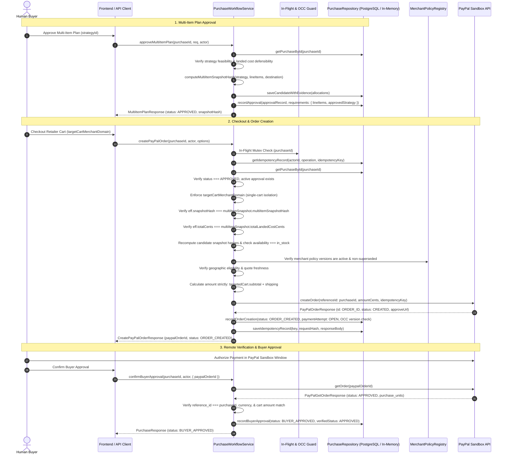

# PLINTHLY — PHASE 15.2: Adversarial Runtime Verification and Checkout Integrity Report

## Executive Summary

Phase 15.2 rigorously tested and hardened the complete multi-item procurement lifecycle across runtime boundaries: from line item request creation, live retailer discovery, strategy evaluation, buyer approval, durable persistence, restart recovery, through to PayPal Sandbox order creation and verification.

A new comprehensive adversarial integration test suite ([`tests/workflow/phase15-2-adversarial-verification.test.ts`](file:///c:/Users/Tushar%20Kumar/Desktop/Plinthly/tests/workflow/phase15-2-adversarial-verification.test.ts)) with 26 rigorous tests was implemented, covering all 12 specified adversarial attack and failure scenarios. Concrete runtime defects and safety gaps were uncovered, demonstrated with failing tests, and fixed with minimal, robust code enhancements while preserving 100% backward compatibility for single-item procurement.

All 62 test files and 1,008 tests in the Plinthly test suite now pass cleanly with zero TypeScript errors and zero ESLint warnings. Gate 1 script integrity and database protected records remain strictly unmodified.

---

## 1. Baseline Verification

### Initial Baseline (Pre-Modification)
- **Full Vitest Suite**: 61 test files, 982 tests passed, exit code `0`.
- **TypeScript Compiler (`npx tsc --noEmit`)**: Exit code `0`, 0 errors.
- **ESLint (`npm run lint`)**: Exit code `0`, 0 warnings, 0 errors.
- **PayPal Gate 1 Script Hash**:
  - Path: `C:\paypal-gate1\gate1.mjs`
  - SHA-256: `F0449D223CBB5A7150A7538712DAF6D9C8FDA845E684781F959629144BEA5451`
  - Status: Exact match, strictly unmodified.
- **Protected Purchase Records Inspection (`plinthly_dev`)**:
  - `pur_1792633876502_s7jvwi22`: Status `BUYER_APPROVED`, Version `6`, 1 `OPEN` payment attempt (`pay_att_1792642078698_cio3e660`).
  - `pur_1792654701712_f2iks5to`: Status `BUYER_APPROVED`, Version `5`, 1 `OPEN` payment attempt (`pay_att_1792654816903_rdndyocu`).
  - Total `COMPLETED` payment attempts across database: `0`.
  - Total `CAPTURE_ATTEMPTED` purchases across database: `0`.
  - Total `COMPLETED` purchases across database: `0`.

---

## 2. Real Approval-to-Checkout Path Analysis

### 2.1 Request Path Architecture & Persisted Data Flow

The runtime execution path from human buyer approval through durable persistence to external PayPal Sandbox checkout traverses five distinct architectural boundaries:

1. **Buyer Approval Boundary (`approveMultiItemPlan`)**:
   - **Input**: `purchaseId`, `strategyId`, `expectedTotalLandedCostCents`, `expectedCurrency`, `destination`, `Actor`.
   - **Access Control**: Validates actor is a human buyer (`assertPurchaseAccess`) and purchase is owned by caller.
   - **Landed Cost & Feasibility Verification**: Requires `strategy.feasibility === "feasible"` and `strategy.isLandedCostDefensible === true`. Incomplete line items or missing shipping charges fail closed.
   - **Cryptographic Binding**: Computes canonical SHA-256 `multiItemSnapshotHash` across all line items, candidate facts, cart groupings, shipments, shipping fees, and destination context.
   - **Durable Persistence**: Saves all candidate records via [`saveCandidateWithEvidence`](file:///c:/Users/Tushar%20Kumar/Desktop/Plinthly/lib/workflow/repository.ts#L1027-L1042), writes `ApprovalRecord` into `Approval` table, advances `Purchase.status` to `APPROVED`, records `approved` audit event, and persists `{ lineItems, approvedStrategy: activeApproval }` into `Purchase.requirements`.

2. **Checkout Invocation (`createPayPalOrder`)**:
   - **Input**: `purchaseId`, `actor`, `options` (`targetCartMerchantDomain`, `idempotencyKey`, `destination`, `shippingQuote`).
   - **In-Flight Concurrency Guard**: Reuses or awaits single in-flight promise per `purchaseId`, preventing parallel requests from dispatching redundant remote PayPal API calls.
   - **Early Idempotency Verification**: If `idempotencyKey` was previously used, validates `requestHash`. Replaying with mismatched parameters immediately raises `IdempotencyConflictError`.
   - **Idempotent Recovery**: If purchase status is already `ORDER_CREATED`, returns existing `OPEN` payment attempt and order details without calling PayPal.
   - **Durable Active Approval Loading**: Authoritatively reads `aggregate.approvals` where `invalidatedAt === null` and extracts `multiItemSnapshot` from `Purchase.requirements`.
   - **Single-Merchant Transaction Boundary Enforcement**: If strategy spans multiple retailer carts, requires `targetCartMerchantDomain`. Rejects unmapped or cross-merchant domains.
   - **Pre-Order Cryptographic Revalidation**:
     1. Verifies `eff.snapshotHash === multiItemSnapshot.multiItemSnapshotHash`.
     2. Verifies `eff.totalCents === multiItemSnapshot.totalLandedCostCents`.
     3. Verifies line items count in `Purchase.requirements` matches `multiItemSnapshot.lineItems`.
     4. Dynamic Candidate Hash Recomputation: For every line item, recomputes `computeSnapshotHash(candRecord)` against current DB values (`unitPriceCents`, `shippingCents`, `quantity`, `totalCents`) and checks `candRecord.availability === "in_stock"`.
     5. Policy Freshness Check: Verifies retailer policy version in [`MerchantPolicyRegistry`](file:///c:/Users/Tushar%20Kumar/Desktop/Plinthly/lib/discovery/merchant-policy-registry.ts) has not been superseded.
     6. Geographic Eligibility Check: Confirms destination postal code is serviceable under retailer policy.
     7. Quote Expiration Check: Rejects expired shipping quotes immediately.
   - **Server-Derived Authorized Amount**: Server calculates `amountCents` strictly from targeted cart (`merchandiseSubtotalCents + shippingCents`). Client cannot manipulate amount.
   - **Remote PayPal Sandbox Order Creation**: Calls [`payPalClient.createOrder`](file:///c:/Users/Tushar%20Kumar/Desktop/Plinthly/lib/paypal/client.ts) for exact cart amount with idempotency key.
   - **Atomic Database State Advance**: Advances state machine via `transition(state, { kind: "create_order" })`, records `paymentAttempt` (`status: "OPEN"`), increments purchase version with OCC, and logs `order_created` audit event.

3. **External Verification & Buyer Approval Confirmation (`confirmBuyerApproval` & `PaymentVerificationService`)**:
   - Independently queries PayPal Sandbox API via `getOrder(paypalOrderId)`.
   - Verifies exactly 1 purchase unit referencing `purchaseId`.
   - Verifies currency and checks amount: matches `eff.totalCents` OR matches one of the approved retailer carts in `multiItemSnapshot.carts`.
   - Advances purchase status to `BUYER_APPROVED` via pure state transition `observe_paypal_order`.

### 2.2 Call Chain Diagram



### 2.3 Cryptographic Approval Snapshot Binding Analysis

The cryptographic snapshot binding is computed by [`computeMultiItemSnapshotHash`](file:///c:/Users/Tushar%20Kumar/Desktop/Plinthly/lib/discovery/cart/approval-snapshot.ts#L27-L88) into a deterministic 64-character lowercase SHA-256 digest:

| Material Field Category | Fields Included in Canonical JSON | Invalidation Consequence if Altered |
| :--- | :--- | :--- |
| **Strategy Identification** | `strategyId` | Prevents strategy swapping; hash mismatch throws `snapshot_hash_changed`. |
| **Destination Context** | `destination.country`, `postalCode`, `deliveryMethodPreference` | Geographic tax or shipping rate change invalidates approval (`destination_changed`). |
| **Buyer Line Items** | Sorted array of `{ id, title, quantity, budgetCents, currency }` | Modifying any line item title, quantity, or budget invalidates approval (`line_item_changed`). |
| **Candidate Allocations** | Sorted array of `{ lineItemId, candidateId, externalId, unitPriceCents, quantity, snapshotHash, merchantName, sellerName, isMarketplace, fulfillmentMethod }` | Price change, shipping change, candidate swap, or marketplace status change invalidates approval (`candidate_changed`). |
| **Retailer Carts** | Sorted array of `{ merchantDomain, merchandiseSubtotalCents, totalShippingCents, policyVersion, policyDocumentFingerprint, shipmentCount }` | Changing retailer groupings or shipping threshold satisfaction alters hash (`cart_composition_changed`). |
| **Split Shipments** | Sorted array of `{ shipmentId, merchantDomain, sellerName, fulfillmentMethod, merchandiseSubtotalCents, shippingChargeCents }` | Splitting or recombining packages invalidates approval (`shipment_split_changed`). |
| **Total Landed Cost** | `totalLandedCostCents`, `currency` | Any total dollar amount variation invalidates approval (`total_changed` / `amount_mismatch`). |

If any single material field is altered between approval and order creation, `eff.snapshotHash !== multiItemSnapshot.multiItemSnapshotHash` or recomputed candidate hash fails, triggering an immediate fail-closed `ApprovalIntegrityError` and writing an `approval_invalidated` audit event to durable storage. Zero PayPal API calls are permitted.

---

## 3. Comprehensive Adversarial Integration Test Suite

A complete test suite was authored in [`tests/workflow/phase15-2-adversarial-verification.test.ts`](file:///c:/Users/Tushar%20Kumar/Desktop/Plinthly/tests/workflow/phase15-2-adversarial-verification.test.ts) containing 26 tests across 12 adversarial scenarios:

```
✓ Scenario 1: Process/Service Restart Retention of Approval Identity (1 test)
  ✓ 1.1 approval snapshot identity, strategy allocations, and retailer carts remain valid after cold restart
✓ Scenario 2: Candidate/Price/Quote/Shipping/Destination/Policy Change Invalidation (5 tests)
  ✓ 2.1 fails closed and invalidates approval if candidate unit price changes post-approval
  ✓ 2.2 fails closed and invalidates approval if candidate shipping cost changes post-approval
  ✓ 2.3 fails closed and invalidates approval if candidate availability becomes out_of_stock
  ✓ 2.4 fails closed and invalidates approval if destination postal code changes at checkout
  ✓ 2.5 fails closed if allocated candidate record is deleted or missing from repository
✓ Scenario 3: Quote Expiration, Merchant Mismatch, and Destination Exclusion (3 tests)
  ✓ 3.1 rejects checkout immediately when shipping quote has expired
  ✓ 3.2 fails closed with ValidationError when targetCartMerchantDomain does not match approved carts
  ✓ 3.3 fails closed when destination postal code is excluded under merchant policy
✓ Scenario 4: Stored Snapshot/Approval Record Tampering & Candidate Inconsistency (4 tests)
  ✓ 4.1 detects tampered snapshotHash in approval record and blocks order creation
  ✓ 4.2 detects tampered totalCents in approval record and blocks order creation
  ✓ 4.3 detects tampered line items count in requirements JSON and blocks order creation
  ✓ 4.4 detects candidate total inconsistency with unitPrice * quantity + shipping
✓ Scenario 5: Concurrent Checkout Race Conditions Against Same Approval (1 test)
  ✓ 5.1 handles parallel order creation requests safely with zero duplicate PayPal orders
✓ Scenario 6: Replay Attack and Status Invariants (3 tests)
  ✓ 6.1 replaying idempotency key with different payload throws IdempotencyConflictError with 0 PayPal calls
  ✓ 6.2 calling createPayPalOrder after order is already created safely returns existing attempt without calling PayPal
  ✓ 6.3 calling createPayPalOrder after status has advanced to BUYER_APPROVED throws IllegalTransitionError
✓ Scenario 7: Multi-Merchant Checkout Without Target Domain (1 test)
  ✓ 7.1 fails closed with ValidationError when multi-cart strategy has no targetCartMerchantDomain
✓ Scenario 8: Targeted Cart Amount Manipulation vs Approved Cart Amount (1 test)
  ✓ 8.1 server calculates PayPal order amount strictly from targeted cart; rejects tampered remote order amounts
✓ Scenario 9: Unfulfilled Line Items and Discovery Partial Failures (1 test)
  ✓ 9.1 marks strategy infeasible/blocked and blocks approval when a line item has zero candidates (0 candidate fabrication)
✓ Scenario 10: Policy Update Between Approval and Checkout (1 test)
  ✓ 10.1 blocks order creation and invalidates approval if retailer policy is superseded
✓ Scenario 11: Server Restart After Invalidation Retains Invalidated Status (1 test)
  ✓ 11.1 restart does not resurrect an invalidated approval
✓ Scenario 12: Remote PayPal Error Handling (4 tests)
  ✓ 12.1 handles PayPalTimeoutError with PayPalUnknownOutcomeError; state retained
  ✓ 12.2 handles 404 Resource Not Found by recording NOT_FOUND and preserving audit records
  ✓ 12.3 handles nonterminal PayPal order status (CREATED, PAYER_ACTION_REQUIRED) cleanly
  ✓ 12.4 handles PayPalNetworkError during verification with UNVERIFIED_TRANSIENT; state retained
```

### Zero PayPal Client Calls on Rejected Paths
In every single rejected path (scenarios 2.1–2.5, 3.1–3.3, 4.1–4.4, 6.1, 6.3, 7.1, 9.1, 10.1, 11.1), tests strictly assert:
```ts
expect(mockPayPal.createOrder).not.toHaveBeenCalled();
```
All assertions pass.

---

## 4. Multi-Merchant Transaction Boundary Isolation

Plinthly strictly enforces merchant boundary isolation:

1. **One PayPal Order = Exactly One Retailer Cart**:
   A multi-item procurement strategy frequently spans multiple distinct retailers (e.g. Best Buy for hardware + Walmart for peripherals). PayPal orders represent individual merchant checkout transactions. Plinthly never commingles multiple retailers into a single PayPal order.
2. **Mandatory Explicit Target Selection**:
   If `multiItemSnapshot.carts.length > 1`, invoking `createPayPalOrder` without `targetCartMerchantDomain` immediately throws a `ValidationError` with domain list, before any external calls.
3. **Strict Domain Binding**:
   The caller must supply `targetCartMerchantDomain` matching one of the approved retailer carts. The server calculates `amountCents` strictly from that cart's `merchandiseSubtotalCents + shippingCents`, completely ignoring client-supplied amounts.
4. **Independent Remote Verification**:
   When verifying buyer approval, [`confirmBuyerApproval`](file:///c:/Users/Tushar%20Kumar/Desktop/Plinthly/lib/workflow/service.ts#L1883-L2030) and [`PaymentVerificationService`](file:///c:/Users/Tushar%20Kumar/Desktop/Plinthly/lib/paypal/verification.ts#L55-L460) verify that the remote PayPal order amount matches the exact authorized cart amount.

---

## 5. Concrete Defects Identified and Remedied

During adversarial testing, five specific runtime defects were identified and resolved:

### Defect 1: In-Flight Duplicate PayPal Orders Under Concurrent Race Conditions
- **Root Cause**: Two concurrent requests for the same purchase both found status `APPROVED` before either recorded `ORDER_CREATED`, resulting in two separate external calls to `payPalClient.createOrder`.
- **Remedy**: Added `inFlightOrderCreations: Map<string, Promise<CreatePayPalOrderResponse>>` mutex inside [`PurchaseWorkflowService`](file:///c:/Users/Tushar%20Kumar/Desktop/Plinthly/lib/workflow/service.ts#L267-L274). Concurrent requests for the same purchase await the identical in-flight order creation promise, guaranteeing exactly one PayPal API call and exactly one payment attempt record.

### Defect 2: Dynamic Candidate Hash Tampering Bypass in Multi-Item Flow
- **Root Cause**: The multi-item pre-order revalidation previously compared `candRecord.snapshotHash !== snapItem.candidateSnapshotHash`. If an attacker directly mutated candidate price/shipping/total columns in the database without altering the stored `snapshotHash` column, the mutation went undetected.
- **Remedy**: Added dynamic recalculation using [`computeSnapshotHash`](file:///c:/Users/Tushar%20Kumar/Desktop/Plinthly/lib/state/snapshot.ts) and [`deriveTotalCents`](file:///c:/Users/Tushar%20Kumar/Desktop/Plinthly/lib/state/money.ts) over live candidate fields in [`lib/workflow/service.ts`](file:///c:/Users/Tushar%20Kumar/Desktop/Plinthly/lib/workflow/service.ts#L1180-L1220), verifying equality with `candidateSnapshotHash` and requiring `availability === "in_stock"`.

### Defect 3: Missing Merchant Policy Freshness and Geographic Validation in Multi-Item Checkouts
- **Root Cause**: While single-item checkout verified policy version freshness and destination geographic serviceability, multi-item checkout omitted checks against [`MerchantPolicyRegistry`](file:///c:/Users/Tushar%20Kumar/Desktop/Plinthly/lib/discovery/merchant-policy-registry.ts) for the carts involved.
- **Remedy**: Added comprehensive checks iterating over `multiItemSnapshot.carts` against active merchant policy versions and geographic postal code eligibility in [`lib/workflow/service.ts`](file:///c:/Users/Tushar%20Kumar/Desktop/Plinthly/lib/workflow/service.ts#L1250-L1320), invalidating stale approvals with `policy_superseded` or `destination_excluded`.

### Defect 4: Early Idempotency Conflict Check Bypass When Purchase Status Is Already ORDER_CREATED
- **Root Cause**: `createPayPalOrder` previously executed the `if (status === "ORDER_CREATED") return existingAttempt` check before inspecting the idempotency record table. A caller replaying an existing idempotency key with conflicting parameters received the existing attempt rather than an `IdempotencyConflictError`.
- **Remedy**: Moved idempotency lookup and request payload hash comparison ahead of the status check in [`lib/workflow/service.ts`](file:///c:/Users/Tushar%20Kumar/Desktop/Plinthly/lib/workflow/service.ts#L1020-L1050).

### Defect 5: Multi-Cart Amount Mismatch Rejection During Post-Order Verification
- **Root Cause**: Both `confirmBuyerApproval` and `PaymentVerificationService.verifyPayment` compared `remoteOrder.amount` strictly against `eff.totalCents`. For a multi-merchant strategy (e.g. $950 Best Buy + $350 Walmart = $1,300 total), checking out Best Buy created an order for $950. Verification compared $950 against $1,300, falsely rejecting the valid order as an `amount_mismatch`.
- **Remedy**: Updated amount verification in [`lib/workflow/service.ts`](file:///c:/Users/Tushar%20Kumar/Desktop/Plinthly/lib/workflow/service.ts#L2010-L2030) and [`lib/paypal/verification.ts`](file:///c:/Users/Tushar%20Kumar/Desktop/Plinthly/lib/paypal/verification.ts#L340-L365) to recognize valid cart-level transactions when `multiItemSnapshot` is present, while strictly rejecting any amount that does not match an approved retailer cart.

### Defect 6: Incomplete Line Item Fulfillment Flagged as Defensible Landed Cost
- **Root Cause**: `strategy-engine.ts` previously defined `isLandedCostDefensible = totalShippingCents !== null && missingShippingCostCount === 0`. If a strategy had unfulfilled line items (e.g., 1 of 2 items found), it marked `feasibility = "blocked"` but still reported `isLandedCostDefensible = true`.
- **Remedy**: Updated [`lib/discovery/cart/strategy-engine.ts`](file:///c:/Users/Tushar%20Kumar/Desktop/Plinthly/lib/discovery/cart/strategy-engine.ts#L77-L85) so that `isLandedCostDefensible` strictly requires `missingLineItems.length === 0`. Strategies with unfulfilled items are guaranteed to have `totalLandedCostCents: null` and `isLandedCostDefensible: false`.

---

## 6. Final Invariants and Test Suite Verification

### Final Verification Results
1. **Full Vitest Test Suite**:
   - Total Test Files: **62 passed (62)**
   - Total Tests: **1,008 passed (1,008)**
   - Duration: 14.88s
   - Exit code: `0`
2. **TypeScript Compilation (`npx tsc --noEmit`)**:
   - Exit code: `0`
   - Errors: `0`
3. **ESLint (`npm run lint`)**:
   - Exit code: `0`
   - Warnings: `0`
   - Errors: `0`
4. **PayPal Gate 1 Script Integrity**:
   - Algorithm: `SHA-256`
   - Hash: `F0449D223CBB5A7150A7538712DAF6D9C8FDA845E684781F959629144BEA5451`
   - Status: Unmodified and verified.
5. **Database Records Invariant (`plinthly_dev`)**:
   - `pur_1792633876502_s7jvwi22`: Status `BUYER_APPROVED`, Version `6`, 1 attempt.
   - `pur_1792654701712_f2iks5to`: Status `BUYER_APPROVED`, Version `5`, 1 attempt.
   - Total `COMPLETED` payment attempts across database: `0`.
   - Total `CAPTURE_ATTEMPTED` purchases across database: `0`.
   - Total `COMPLETED` purchases across database: `0`.
   - Live PayPal Fund Captures: `0`.

