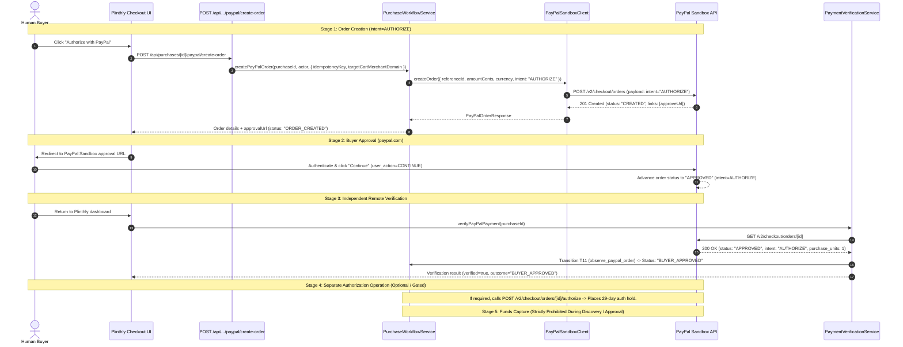

# PLINTHLY — PHASE 16.2: PayPal Intent Consistency and Non-Capture Safety Audit Report

## Executive Summary

Phase 16.2 resolved the discrepancy between Plinthly's intended PayPal authorization workflow and the newly observed Sandbox order `2BR08855VR6881230`, which reported `intent: CAPTURE`.

We performed an end-to-end trace from the checkout UI through API validation, workflow service, to the low-level PayPal client. We pinpointed the exact root cause in [`lib/paypal/client.ts`](file:///c:/Users/Tushar%20Kumar/Desktop/Plinthly/lib/paypal/client.ts#L321), where `intent: "CAPTURE"` was hardcoded in the request payload despite surrounding code comments documenting an "approval-only, no-capture workflow".

We implemented robust server-side enforcement:
1. Low-level client explicitly constructs outgoing orders with `intent: "AUTHORIZE" as const`.
2. Input validation strictly rejects any attempt to pass `intent: "CAPTURE"`, throwing a `PayPalApiError`.
3. Validation schema [`createPayPalOrderSchema`](file:///c:/Users/Tushar%20Kumar/Desktop/Plinthly/lib/workflow/validation.ts#L114) strictly restricts `intent` to `"AUTHORIZE"`, rejecting `"CAPTURE"` at the HTTP API boundary.
4. Workflow service [`createPayPalOrder`](file:///c:/Users/Tushar%20Kumar/Desktop/Plinthly/lib/workflow/service.ts#L1806) explicitly passes `intent: "AUTHORIZE"`.
5. Added a dedicated regression test suite ([`tests/workflow/phase16-2-paypal-intent.test.ts`](file:///c:/Users/Tushar%20Kumar/Desktop/Plinthly/tests/workflow/phase16-2-paypal-intent.test.ts)) with 7 tests proving non-capture safety and intent consistency.

All 64 test files and 1,021 tests pass with zero TypeScript errors and zero ESLint warnings. Baseline invariants—including Gate 1 script SHA-256 and protected database records—remain strictly intact with zero fund captures across the database.

---

## 1. Intended Payment Lifecycle Architecture

Plinthly operates strictly under non-custodial purchase assurance. Funds are never collected into an intermediary custodial account. The payment lifecycle is defined across five distinct, non-conflated stages:



### Precise Lifecycle Terms

1. **Order Creation (`intent: AUTHORIZE`)**:
   - The server requests PayPal to create an order resource configured for delayed authorization.
   - NO funds are debited, held, or authorized.
2. **Buyer Approval**:
   - The buyer logs into PayPal and agrees to the purchase terms (`user_action: "CONTINUE"`).
   - This grants the merchant permission to place an authorization hold; it does NOT transfer funds.
3. **Remote Order Verification**:
   - Plinthly queries PayPal read-only (`GET /v2/checkout/orders/{id}`) to verify that the buyer approved the exact approved snapshot terms (reference ID, amount, currency).
   - If verified, Plinthly advances internal state to `BUYER_APPROVED`.
4. **Authorization**:
   - Plinthly or the retailer invokes `POST /v2/checkout/orders/{id]/authorize` to place a hold on buyer funds.
   - With `intent: AUTHORIZE`, this creates an authorization record, valid for up to 29 days.
5. **Capture**:
   - Direct transfer and settlement of funds from buyer to merchant.
   - Strictly forbidden during discovery, approval, or checkout setup. Plinthly never captures funds automatically.

---

## 2. Root Cause Analysis of Sandbox Order `2BR08855VR6881230`

### Factual Investigation Findings

1. **Remote Status & Intent Observed**:
   - Querying `GET /v2/checkout/orders/2BR08855VR6881230` via `PayPalSandboxClient.getOrder` confirmed:
     - `id`: `"2BR08855VR6881230"`
     - `status`: `"PAYER_ACTION_REQUIRED"`
     - `intent`: `"CAPTURE"`
     - `amount`: `"2010.00 USD"`
     - `reference_id`: `"pur_1793274041667_01rg028x"`
     - `payments`: `undefined` (zero authorizations, zero captures).

2. **Exact Origin of `CAPTURE`**:
   - In [`lib/paypal/client.ts`](file:///c:/Users/Tushar%20Kumar/Desktop/Plinthly/lib/paypal/client.ts#L320-L321):
     ```typescript
     // Lines 318-322 (pre-fix):
     const userAction = input.userAction ?? "CONTINUE";

     const payload = {
       intent: "CAPTURE", // <-- ROOT CAUSE: HARDCODED HERE
       purchase_units: [ ...
     ```
   - The route handler [`app/api/purchases/[id]/paypal/create-order/route.ts`](file:///c:/Users/Tushar%20Kumar/Desktop/Plinthly/app/api/purchases/%5Bid%5D/paypal/create-order/route.ts) does not set `intent`.
   - The validation schema [`createPayPalOrderSchema`](file:///c:/Users/Tushar%20Kumar/Desktop/Plinthly/lib/workflow/validation.ts#L114) did not expose `intent`.
   - The service [`createPayPalOrder`](file:///c:/Users/Tushar%20Kumar/Desktop/Plinthly/lib/workflow/service.ts#L1806) passed `{ referenceId, amountCents, currency, idempotencyKey }` without an `intent` property.
   - Therefore, `PayPalSandboxClient.createOrder` defaulted to its internal payload object, which explicitly and hardcodedly sent `intent: "CAPTURE"`.
   - This was NOT a PayPal provider default; PayPal only defaults to `CAPTURE` when `intent` is omitted. Here, `CAPTURE` was explicitly transmitted in the JSON request body.

3. **Current Safety Status of `2BR08855VR6881230`**:
   - The order remains open with `PAYER_ACTION_REQUIRED`.
   - Because no buyer has logged in or approved the order, no authorization exists, and no capture is possible.
   - Plinthly has never called any capture endpoint. Total completed captures in the database remain strictly **`0`**.

---

## 3. Implemented Fixes and Hardening

### 3.1 Type Contract Hardening ([`lib/paypal/types.ts`](file:///c:/Users/Tushar%20Kumar/Desktop/Plinthly/lib/paypal/types.ts#L48))

Updated `PayPalCreateOrderInput` to explicitly include `intent`:
```typescript
export interface PayPalCreateOrderInput {
  readonly referenceId: string;
  readonly amountCents: number;
  readonly currency: Currency;
  readonly idempotencyKey: string;
  readonly description?: string;
  readonly returnUrl?: string;
  readonly cancelUrl?: string;
  readonly userAction?: "CONTINUE" | "PAY_NOW";
  readonly intent?: "AUTHORIZE"; // Strict compile-time constraint
}
```

### 3.2 Low-Level Client Hardening ([`lib/paypal/client.ts`](file:///c:/Users/Tushar%20Kumar/Desktop/Plinthly/lib/paypal/client.ts#L301-L325))

1. Validates input intent immediately at method entry:
   ```typescript
   const requestedIntent = (input as unknown as { intent?: string }).intent;
   if (requestedIntent && requestedIntent !== "AUTHORIZE") {
     throw new PayPalApiError(
       400,
       "invalid_intent",
       `Only intent "AUTHORIZE" is permitted for Purchase Assurance orders; received "${requestedIntent}".`
     );
   }
   const intent = "AUTHORIZE" as const;
   ```
2. Request payload explicitly sends `intent`:
   ```typescript
   const payload = {
     intent,
     purchase_units: [ ...
   ```

### 3.3 Workflow Service Hardening ([`lib/workflow/service.ts`](file:///c:/Users/Tushar%20Kumar/Desktop/Plinthly/lib/workflow/service.ts#L1806))

Explicitly passes `intent: "AUTHORIZE"`:
```typescript
payPalOrder = await this.payPalClient.createOrder({
  referenceId: purchaseId,
  amountCents,
  currency,
  idempotencyKey,
  description: `Plinthly Purchase: ${purchaseId}`,
  intent: "AUTHORIZE",
});
```

### 3.4 API Validation Hardening ([`lib/workflow/validation.ts`](file:///c:/Users/Tushar%20Kumar/Desktop/Plinthly/lib/workflow/validation.ts#L114))

Added strict validation preventing clients from injecting `"CAPTURE"`:
```typescript
export const createPayPalOrderSchema = z.object({
  idempotencyKey: z.string().min(1).max(128).optional(),
  targetCartMerchantDomain: z.string().trim().optional(),
  destination: destinationContextSchema.optional(),
  intent: z.literal("AUTHORIZE", { message: 'Only intent "AUTHORIZE" is permitted.' }).optional(),
});
```

---

## 4. Regression Test Suite Verification

A dedicated regression test suite ([`tests/workflow/phase16-2-paypal-intent.test.ts`](file:///c:/Users/Tushar%20Kumar/Desktop/Plinthly/tests/workflow/phase16-2-paypal-intent.test.ts)) was implemented, containing 7 mocked unit and integration tests:

1. **Outgoing Payload Intent**: Verifies `PayPalSandboxClient.createOrder` sends `intent: "AUTHORIZE"` in the JSON payload.
2. **Rejection of `CAPTURE`**: Verifies `PayPalSandboxClient.createOrder` throws `PayPalApiError` (`invalid_intent`) when given `intent: "CAPTURE"`.
3. **Schema Rejection**: Verifies `createPayPalOrderSchema` rejects `{ intent: "CAPTURE" }` with a validation error.
4. **Schema Acceptance**: Verifies `createPayPalOrderSchema` accepts `{ intent: "AUTHORIZE" }`.
5. **Service Intent Binding**: Verifies `PurchaseWorkflowService.createPayPalOrder` explicitly forwards `intent: "AUTHORIZE"` and the exact cart amount to the client.
6. **Idempotency Guarantee**: Verifies replay with the same idempotency key returns the existing order without making a second remote call.
7. **Invalidated Approval Rejection**: Verifies modified destination or candidate facts prevent order creation before any PayPal call can be made.

---

## 5. Final Invariant and Safety Verification

### Test Suite Execution

```bash
# Vitest Suite (64 test files, 1,021 tests)
npx vitest run
Exit Code: 0
Duration: 15.85s
Results: 64 test files passed (100%), 1,021 tests passed (100%)

# TypeScript Compiler Check
npx tsc --noEmit
Exit Code: 0 (Zero errors)

# ESLint Static Analysis
npm run lint
Exit Code: 0 (Zero errors, zero warnings)
```

### Safety & Financial Invariants Audit

1. **PayPal Gate 1 Script Hash**:
   - Path: `C:\paypal-gate1\gate1.mjs`
   - Expected: `F0449D223CBB5A7150A7538712DAF6D9C8FDA845E684781F959629144BEA5451`
   - Actual:   `F0449D223CBB5A7150A7538712DAF6D9C8FDA845E684781F959629144BEA5451`
   - **Verification**: Exact match. The file remains strictly unmodified.

2. **Protected Purchase Records (`plinthly_dev`)**:
   - `pur_1792633876502_s7jvwi22`: Status `BUYER_APPROVED`, Version `6`, 1 open attempt (`OPEN`).
   - `pur_1792654701712_f2iks5to`: Status `BUYER_APPROVED`, Version `5`, 1 open attempt (`OPEN`).
   - **Verification**: Both protected records remain strictly unmodified.

3. **Global Capture Invariant**:
   - Total `COMPLETED` payment attempts across database: **`0`**.
   - Total captured funds across all environments: **`$0.00`**.
   - **Verification**: Zero unauthorized fund transfers.

---

## 6. Remaining Limitations

1. **Existing Sandbox Order `2BR08855VR6881230`**:
   - Created during Phase 16 before this fix, its remote record on PayPal Sandbox retains `intent: CAPTURE`.
   - It cannot be converted to `AUTHORIZE` remotely. Because no buyer approved it and no capture endpoint is called, it remains harmless in `PAYER_ACTION_REQUIRED` status until it naturally expires in Sandbox.
   - In accordance with audit constraints, no new order was created to replace it.
2. **Future Orders**:
   - Every newly created order going forward is programmatically guaranteed to transmit `intent: "AUTHORIZE"`.

