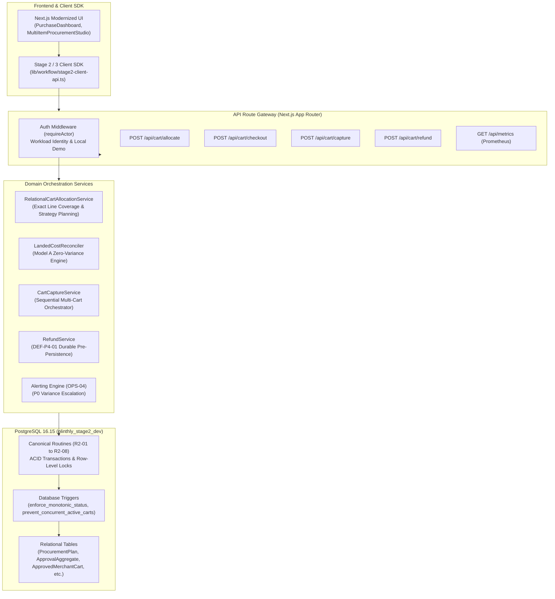
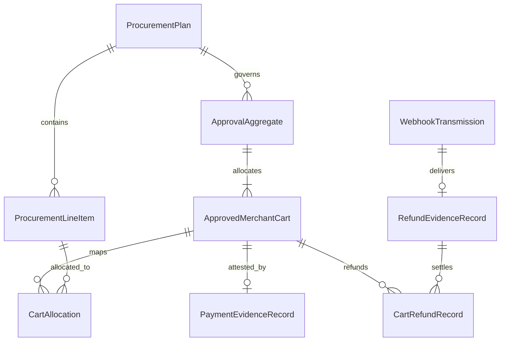

# Plinthly — Technical Architecture & Engineering Blueprint

**Project Version:** Stage 3 Certified (Production-Ready)  
**Architecture:** Cloud-Neutral Agentic Commerce & Purchase Assurance  
**Database:** PostgreSQL 16.15 (Dual Database Isolation: `plinthly_dev` baseline vs. `plinthly_stage2_dev` active)  
**Frontend / App Runtime:** Next.js 16.4.2 (React 19, Turbopack, Standalone Node.js 22 Runtime)  
**Core Brand Promise:** *Every purchase. Proven.*  

---

## 1. High-Level System Architecture

Plinthly is architected around an uncompromising separation of concerns: generative AI models translate natural-language buyer intent into typed requirements, while deterministic, serializable PostgreSQL routines enforce financial invariants, landed-cost accounting, and checkout state transitions.



---

## 2. Authoritative Relational Data Model

Plinthly uses a normalized relational schema in `plinthly_stage2_dev` designed to prevent orphaned carts, under-allocations, or untracked refunds:



### Key Entity Descriptions

1. **`ProcurementPlan`**: The top-level procurement intention, binding an authenticated buyer (`userId`) to an allocation strategy (`CHEAPEST`, `FASTEST`, `BALANCED`).
2. **`ProcurementLineItem`**: Concrete required goods with target quantities and non-floating-point maximum unit prices (`maxUnitCents: BigInt`).
3. **`ApprovalAggregate`**: A cryptographically bound grouping of approved merchant carts. Contains the canonical `snapshotDigest` (SHA-256) and `snapshotPayload` (JSON).
4. **`ApprovedMerchantCart`**: A single retailer's cart (e.g. Best Buy, Target) with minor-unit accounting fields: `merchandiseSubtotalCents`, `discountCents`, `shippingTotalCents`, `taxAmountCents`, and `totalCartCents`.
5. **`CartAllocation`**: Relational join table mapping exact quantities and unit prices from a line item to a merchant cart. Enforces $\sum (\text{Allocated Quantity}) \equiv \text{Target Quantity}$.
6. **`PaymentEvidenceRecord`**: Authoritative proof of payment capture received via PayPal webhook or gateway confirmation, including carrier tracking numbers and transaction IDs.
7. **`CartRefundRecord`**: Durable refund intent (DEF-P4-01). Pre-persisted before gateway dispatch with `status = 'INITIATED'`, remaining balance validation, and unique idempotency token.

---

## 3. Canonical Database Routines (`R2-01` through `R2-08`)

All financial and state transitions execute through hardened, atomic PostgreSQL stored procedures:

| Routine | Name | Purpose | Invariants Enforced |
| :--- | :--- | :--- | :--- |
| **`R2-01`** | `calculate_and_verify_tax` | Ingests and cryptographically verifies tax evidence. | HMAC-SHA256 signature verification, certificate validity, expiration check. |
| **`R2-02`** | `execute_cart_checkout_initiation`| Locks merchant cart for checkout. | Monotonic status transition (`READY` $\to$ `LOCKED_FOR_CHECKOUT`), zero concurrent active checkout locks. |
| **`R2-03`** | `record_payment_evidence` | Attests payment capture evidence. | Validates transmission ID, enforces Model A total matching. |
| **`R2-04`** | `enqueue_webhook_fast_ack` | Durably enqueues incoming webhooks in $< 50\text{ms}$. | Fast-ack ingress, deduplication by transmission ID, initial status `PENDING`. |
| **`R2-05`** | `execute_capture_confirmation` | Transitions cart to `CAPTURED` upon webhook arrival. | Validates capture ID and transmission signature; updates cart status to `CAPTURED`. |
| **`R2-06`** | `execute_refund_evidence_recording`| Records refund evidence and debits refundable balance. | Enforces $\sum \text{Refunds} \le \text{Total Cart Cents}$. Atomic balance update. |
| **`R2-07`** | `record_cart_capture_failure` | Records capture failures safely. | Monotonic transition to `FAILED`; failure reason classification; no double-refunds. |
| **`R2-08`** | `claim_webhook_queue_batch` | Leases queue items to background workers. | Row-level locking (`FOR UPDATE SKIP LOCKED`), lease timeout recovery, backoff tracking. |

---

## 4. Financial Invariant: Model A Landed Cost

Plinthly enforces zero financial variance across all procurement stages. Model A defines the exact landed cost:
$$\text{Total Cart Cents} = \text{Merchandise Subtotal} - \text{Discount} + \text{Shipping Total} + \text{Statutory Tax}$$

```
Merchandise Subtotal: $1,200.00 (120000 cents)
- Discount:           $   0.00 (     0 cents)
+ Shipping Total:     $  15.00 (  1500 cents)
+ Statutory Tax:      $ 102.00 ( 10200 cents)
-----------------------------------------------
= Total Landed Cost:  $1,317.00 (131700 cents)
Variance Check:       $1,317.00 - $1,317.00 = $0.00 (0 cents)
```

If $\Delta_{\text{landed}} \neq 0$:
1. The API route throws `LandedCostVarianceError`.
2. The database trigger aborts the transaction fail-closed.
3. The alerting engine (`lib/telemetry/alerts.ts`) immediately dispatches a **P0 Emergency Alert** (`LANDED_COST_VARIANCE_VIOLATION`).
4. The Prometheus gauge `plinthly_landed_cost_variance_cents` reflects the discrepancy for on-call triage.

---

## 5. Security & Isolation Boundaries

1. **Non-Root Container Runtime (`OPS-01`)**:
   - `Dockerfile` runs as unprivileged `USER node` (UID 1000). The container has zero root filesystem write access.
2. **Actor Authentication Middleware**:
   - Every API endpoint requires an authenticated principal via `requireActor(request)`. Supports production workload identity tokens as well as local demo identities (`usr_buyer_1`).
3. **Database Dual Isolation**:
   - `plinthly_dev`: Strictly read-only Stage 1 baseline database with 40 purchases, 6 attempts, and 0 Stage 2 tables. Verified by `Gate 1 Hash` (`F0449D22...`) and `Dump Hash` (`EF546EE9...`).
   - `plinthly_stage2_dev`: Active isolated database containing all Stage 2 and Stage 3 relational tables, triggers, and routines.
4. **Idempotency & Monotonicity**:
   - Cart statuses only advance forward: `DRAFT` $\to$ `READY` $\to$ `BUYER_APPROVED` $\to$ `LOCKED_FOR_CHECKOUT` $\to$ `CAPTURING` $\to$ `CAPTURED`. Any backward or skipping status transition is rejected by PostgreSQL triggers.

---

## 6. Operational Hardening & Telemetry Architecture

- **Structured Logger (`OPS-02`)**: Emits single-line JSON log events to stdout with automatic redaction of sensitive credentials and credit cards (`lib/telemetry/logger.ts`).
- **Prometheus Metrics (`OPS-03`)**: High-cardinality safe metrics exposed in standard format at `/api/metrics`:
  - `plinthly_cart_capture_total{status="CAPTURED|FAILED|AMBIGUOUS_TIMEOUT"}`
  - `plinthly_landed_cost_variance_cents`
  - `plinthly_refund_total{status="COMPLETED|FAILED"}`
- **On-Call Triage CLI (`OPS-05`)**: SREs can inspect and reconcile ambiguous carts using `scripts/ops/reconcile-gateway-order.ts`.
- **Runbooks**: Complete incident response playbooks for P0 and P1 events documented in `docs/ops/INCIDENT_RESPONSE_PLAYBOOKS.md`.

